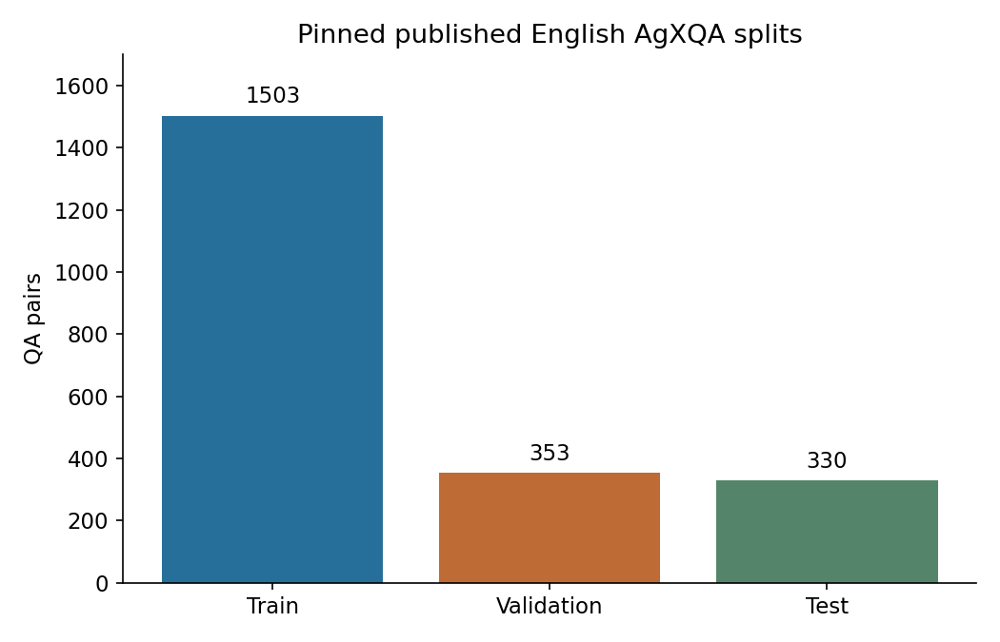
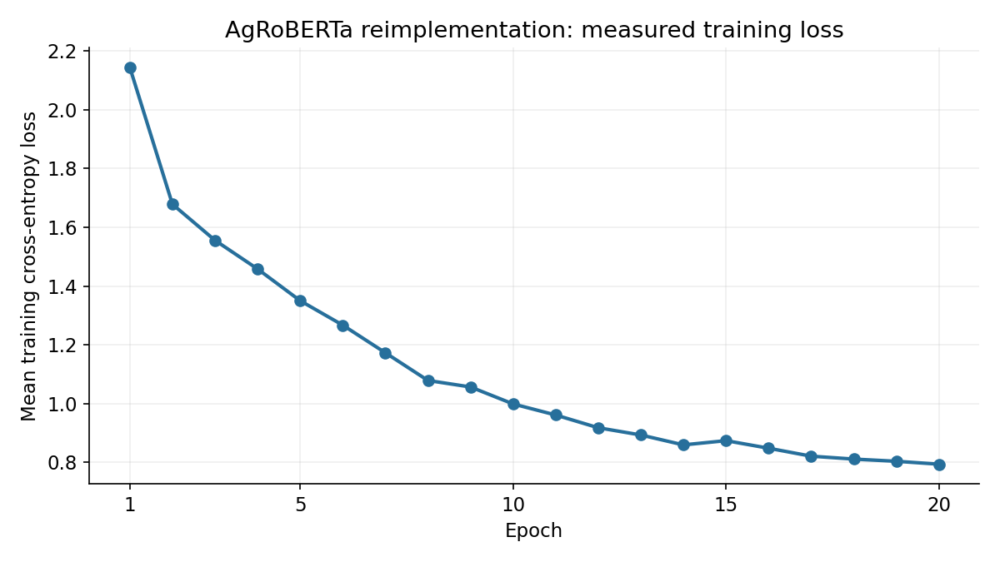
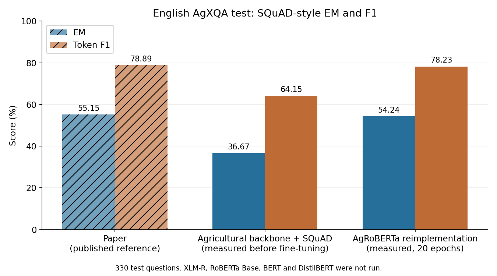
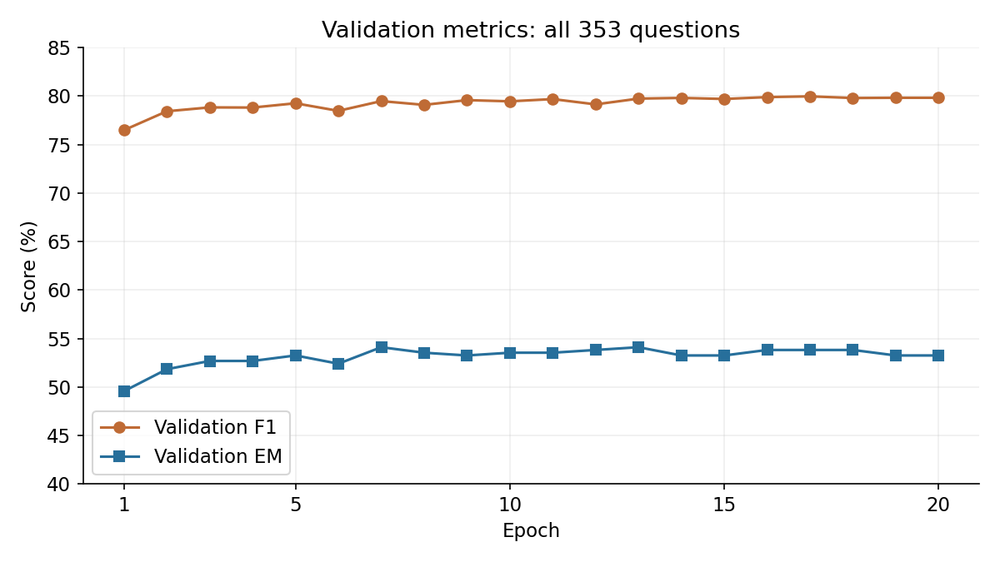

# Phase 1 — Original AgXQA Baseline

**Assigned to:** Saunak

**Review / completion checklist:** Dhiraj

**Status:** Partial. AgRoBERTa reimplementation completed and verified; mandatory English XLM-R training and checkpoint publication remain pending.

## 1. Objective

Reproduce the original English AgXQA baseline with traceable EM/F1, code, configuration and question-wise predictions, then establish an English-trained XLM-R checkpoint for subsequent multilingual phases. This contribution packages the **completed AgRoBERTa experiment**; it does not claim that the entire multi-model Phase 1 is finished.

## 2. Original Research Paper

Kpodo, Kordjamshidi and Nejadhashemi (2024), *AgXQA: A benchmark for advanced Agricultural Extension question answering*, Computers and Electronics in Agriculture 225, 109349. [Paper / DOI](https://doi.org/10.1016/j.compag.2024.109349) · [authors' source](https://github.com/MSU-CECO/agxqa_benchmark_v1/tree/8626771b289d48cff113f0c13d0603ac644628c0).

The published AgRoBERTa scores are **55.15% EM / 78.89% token F1**. They are reference values from the paper, not our measurements. Evaluating an authors' released QA checkpoint would be different from training a reimplementation. The supplied audit found the trained adapter/head missing from the pinned QA release, so this experiment trained its own modules from the released agricultural backbone and public SQuAD initialization. No original authors' QA weights were evaluated.

## 3. Dataset Description

- **Dataset:** `msu-ceco/agxqa_v1`; English extractive QA, agriculture/irrigation.
- **Pinned revision:** `9fb0cf2a6d03ccfccbd67d5966179b43b5b77e2c`.
- **Rows:** `id`, `question`, supplied `context`, and parallel `answers.text` / `answers.answer_start` arrays.
- **Official files:** `agxqa-{train,validation,test}-2024-06-11.jsonl`.
- **Input to model:** the question paired with its supplied paragraph. No retrieval, translation or answer generation stage is used.

Raw dataset files are downloaded from the original source and are not committed here. Retain their original terms; the repository's pending code-license decision does not grant rights over third-party datasets. See [the pinned dataset](https://huggingface.co/datasets/msu-ceco/agxqa_v1/tree/9fb0cf2a6d03ccfccbd67d5966179b43b5b77e2c).

## 4. Dataset Statistics

The loader verified these counts against the pinned downloaded bytes, rather than assuming them from a planning document:

| Split | QA pairs | Token windows | Multi-reference rows | Invalid answer-offset entries |
| --- | ---: | ---: | ---: | ---: |
| Train | 1,503 | 1,578 | 0 | 0 |
| Validation | 353 | 368 | 0 | 0 |
| Test | 330 | 342 | 59 | 9 across five rows |
| **Total** | **2,186** | — | — | — |

All rows have gold answers; IDs are unique across splits. SHA-256 hashes, affected offset IDs and the overlap audit are in [dataset_statistics.json](results/dataset_statistics.json). Of 330 test rows, **309 (93.64%) share a context verbatim with train**. One question–context pair also repeats across train/test under different IDs. These official splits were kept intact.



## 5. Data Preprocessing

The fast RoBERTa tokenizer pairs question and context, truncates only context, right-pads to 384 total tokens and creates context windows with a 128-token overlap. Original character offsets map decoded spans back to row IDs. Question/special/padding tokens are excluded from answer candidates.

Training labels use the first reference with an exact valid stored offset. Answer-free windows receive CLS labels, even when the overall question is answerable. Zero-length tokenizer offsets are skipped for label alignment. Leading/trailing answer whitespace is ignored only when constructing token labels; 161 training rows required that adjustment. Original answer strings, stored offsets and file hashes were unchanged. All 1,503 training rows were retained.

Nine incorrect test answer offsets across IDs `1170477`, `1174212`, `1183012`, `1181597` and `481` remain untouched. Scoring uses their original gold strings. The repository's shared QA contract requires additional fields and strict valid spans; the raw official release is therefore handled by the phase-specific pinned-data loader, not silently repaired to pass the shared validator.

## 6. Model Architectures

```text
Question + context → tokenizer
    → 12 agricultural RoBERTa encoder blocks
      (frozen backbone; one trained Pfeiffer adapter inside each block)
    → QA projection: 768 dimensions → start/end score per token
    → best valid original-context span
```

| Component | Initialization / size | Updated? |
| --- | --- | --- |
| Agricultural backbone | `msu-ceco/roberta-ft-on-agextcorpus-2023-12-10_v2`, revision `bdfdd689aede30b4d7d84cb6e267b98a88d58e40`; 12 layers, hidden width 768 | Frozen: 124,645,632 parameters including unused pooler |
| Pfeiffer adapters | `AdapterHub/roberta-base_qa_squad1_pfeiffer`, revision `059c341c1e82b0b8e418d76a2c5113af41326310`; bottleneck 768 → 48 → 768 | Yes: 894,528 parameters |
| Existing SQuAD QA head | One start/end projection, 768 → 2 | Yes: 1,538 parameters |

Total loaded parameters: **125,541,698**. Trainable: **896,066**, about **0.714%**. The MLM output head is removed; the QA head extracts spans rather than generating next tokens.

The backbone model card's **10 epochs** describe the authors' agricultural masked-language-model pretraining on AEC v1, which was already complete when downloaded. Our **20 epochs** describe a separate AgXQA adapter/head QA stage. The 20-epoch setting came from the supplied handoff's audit of the QA release's saved `training_args.bin`; that binary was not independently unpickled here. The QA model card itself does not state a QA epoch count.

**Other models:** English XLM-R is mandatory but unrun. General RoBERTa Base is recommended and unrun. BERT Base and DistilBERT are optional and unrun. Our agricultural backbone + SQuAD initialization is not a measured general RoBERTa Base baseline.

## 7. Experimental Methodology

A custom PyTorch loop was used, with Adapters for loading/saving modules and Transformers for tokenization, seeding and the linear scheduler. The exact executed core is included under [src/agxqa](src/agxqa); its hashes are preserved in [run metadata](results/provenance/run_metadata.json).

The completed sequence was:

1. Download and hash-validate all official splits and pinned model components.
2. Check inference on four validation rows.
3. Make two training updates on eight training rows, check backbone freezing, save/reload adapter and head, and compare predictions/logits.
4. Evaluate the unmodified initialization on all 330 test rows.
5. Train adapters/head for 20 epochs, evaluating all 353 validation rows after each epoch.
6. Select the final epoch under the predefined **last checkpoint** rule.
7. Reload that saved checkpoint and evaluate all 330 test IDs.
8. Independently rescore frozen predictions, verify spans/coverage, and export this package.

The test set did not select decoding settings or checkpoints. Highest observed validation F1 was at epoch 17 (79.980147%); epoch 20 was still used. The baseline and final comparisons are from one fixed-seed completed run, not an average over seeds.

An initial full-data attempt exposed a zero-length-offset alignment bug; a preflight then exposed trailing-whitespace boundaries. Both were fixed with regression tests before the completed run. A short CPU attempt was interrupted and restarted from original initialization on the Mac's MPS GPU after MPS was found unavailable inside the execution sandbox but available outside it. Original input bytes and the 384/128 decoding defaults stayed fixed. No model was rerun to package these results.

## 8. Training Configuration

[configs/baseline_config.yaml](configs/baseline_config.yaml) contains the **actual AgRoBERTa configuration**. [configs/xlmr_proposed_config.yaml](configs/xlmr_proposed_config.yaml) contains the user-suggested XLM-R starting configuration, explicitly marked proposed/not run. Phase scripts reject that proposed file as an unsupported experiment rather than pretending it was trained.

| Setting | Actual AgRoBERTa value |
| --- | --- |
| Epochs / optimizer updates | 20 / 7,900 |
| Train / evaluation batch size | 4 / 4 |
| Learning rate / schedule / warmup | `5e-5` / linear decay / 0 steps |
| Optimizer / weight decay | PyTorch AdamW / 0.02; biases and 1-D normalization parameters excluded from decay |
| Adam beta1 / beta2 / epsilon | 0.9 / 0.999 / `1e-8` |
| Gradient accumulation / clipping | 1 / norm 1.0 |
| Seed | 42 |
| Precision / device | float32 / Apple MPS; fp16 and bf16 disabled |
| Attention / padding | eager / right-padding to max length |
| Max sequence / stride / max answer | 384 / 128 / 30 tokens |
| Candidate starts/ends per window | Top 20 of each after context restriction |
| No-answer decoding | Disabled; original authors' exact policy unknown |
| Checkpoints / selection | Every 500 updates plus final / last completed epoch |

There are `ceil(1578 / 4) = 395` updates per epoch, retaining the two-window final batch; `395 × 20 = 7900`. The loss is the average of start/end cross entropy. The 30-token cap applies to decoding, not to truncating gold training answers.

Recorded environment: Python 3.11.14, PyTorch 2.8.0, Adapters 1.3.0, Transformers 4.57.6, Tokenizers 0.22.2, NumPy 2.2.6, Hugging Face Hub 0.36.0, Safetensors 0.6.2. The training lock file preserves the resolved environment; Matplotlib 3.10.8 was added later for plotting. Exact GPU chip and RAM were not recorded. The loop's monotonic training time was **5296.853332 seconds (88.28 minutes)**; it is not a GPU-kernel benchmark.

## 9. Evaluation Metrics

**Primary paper-comparison protocol: `squad_v1_english`.** Lowercase; delete ASCII punctuation; remove English articles `a`, `an`, `the`; collapse whitespace. EM compares normalized strings. Token F1 uses multiset token overlap. For multiple references, maximize EM and F1 separately. Aggregate each metric over all questions on a 0–100 scale; per-question scores are 0–1.

**Repository shared protocol: `agxqa-indic-v1`.** NFC/casefold, Unicode punctuation replaced by spaces, no English article removal, and a different empty-token convention. Those scores must not be substituted into the paper-comparison table. The repository's shared scorer was not modified.

For downstream comparison, [shared_protocol_results.json](results/shared_protocol_results.json) rescored the same frozen English predictions using `shared.metrics.best_scores`, without model inference or gold-offset repair:

| Model / frozen predictions | Shared-protocol EM | Shared-protocol F1 |
| --- | ---: | ---: |
| Before fine-tuning | 33.030303 | 64.452450 |
| Reimplementation | 51.515152 | 78.239928 |

This is a metric-only bridge, not a claim that the original raw records pass the repository's strict normalized-QA schema. Predictions include `id`, `language`, and `prediction_text` for compatibility, plus the requested `model`, `question`, `gold_answer`, `gold_answers`, `predicted_answer`, `exact_match` and `f1`. The per-row metric fields identify SQuAD-style scoring explicitly.

## 10. Experimental Results

| Model | Status | Paper-comparison EM | Paper-comparison F1 |
| --- | --- | ---: | ---: |
| AgRoBERTa (published) | Reference only | 55.15 | 78.89 |
| Agricultural backbone + SQuAD initialization | Measured before AgXQA fine-tuning | 36.666667 | 64.145346 |
| **AgRoBERTa reimplementation** | **Measured: 20 epochs, final checkpoint** | **54.242424** | **78.225654** |
| XLM-R Base | Not run | — | — |
| RoBERTa Base | Not run | — | — |
| BERT Base | Not run | — | — |
| DistilBERT | Not run | — | — |

See [baseline_results.json](results/baseline_results.json), [model_comparison.csv](results/model_comparison.csv), [all test predictions](results/test_predictions.jsonl), and [20-epoch logs](results/training_logs.csv). Unmeasured model rows have blank numeric fields, not zero or illustrative values.

## 11. Published vs Reproduced Results

The reimplementation is lower than the paper by **0.907576 percentage points EM** and **0.664346 points F1**. Both are within one percentage point, but the printed numbers were not reproduced exactly. This is a descriptive comparison, not a statistical equivalence test or exact original-weight reproduction.

Fine-tuning improved EM by **17.575758 points** and F1 by **14.080308 points** relative to the measured initialization. Both evaluations cover exactly 330 test IDs. The final adapter/head were reloaded for evaluation. The frozen-backbone hash was unchanged; both trainable components changed. The smoke checkpoint reloaded with identical weights, predictions and logits (maximum absolute logit difference 0.0).

## 12. Training Visualizations







**Validation loss was not recorded in the original run.** `training_logs.csv` leaves that field blank. [validation_loss.png](results/plots/validation_loss.png) is an explicit availability notice, not a fabricated curve. A measured training-versus-validation-loss plot requires a future authorized run that logs validation loss. [Plot notes](results/plots/README.md) identify every source and limitation.

## 13. Error Analysis

Measured categories on the frozen final test predictions:

| Category | Questions |
| --- | ---: |
| Normalized exact answer | 179 |
| Nonexact answer with positive token overlap | 134 |
| Nonexact answer with zero token overlap | 17 |
| **Total** | **330** |

[error_analysis.json](results/error_analysis.json) provides the definitions and lowest-F1 nonexact IDs for review. All references, including bad published offsets and multiple answers, were preserved. These categories do not prove a cause of failure; boundary errors, answer-length limits, annotation issues and semantic alternatives require qualitative review. No questions were excluded to improve metrics.

## 14. Key Observations

- The public agricultural backbone plus SQuAD adapter/head is a working before-fine-tuning baseline.
- Updating only about 0.714% of parameters substantially improved the official English test scores.
- The final result is close to the published QA scores, with an explicit remaining gap.
- Frozen-backbone and checkpoint reload checks passed; 15 synthetic tests cover scoring, configuration and token alignment/decoding.
- The repository's shared normalization changes the English EM figure, so future phases must compare like protocols.
- Phase 1 still needs its second mandatory output: an English-trained XLM-R checkpoint for Experiment 3A.

## 15. Limitations

This is one reimplementation with one seed. Original trained QA weights, exact original decoding settings and original paper checkpoint selection remain unavailable. The 20-epoch original-setting evidence comes from the supplied audit, not a new binary inspection. The original backbone's 10-epoch pretraining was not repeated. Different library/device kernels can change numerical results.

The official test has substantial train-context overlap and does not establish document-disjoint generalization. All pinned rows are answerable although the QA card mentions unanswerable questions; original abstention settings are unresolved. The 94.37% expert-agreement (AgEES) claim was not tested. Validation loss was not logged. XLM-R and other proposed baseline models were not run. No model artifact has been uploaded to public storage. Optimizer state was saved, but automatic interrupted-run resume is not implemented.

## 16. Steps to Reproduce

Use Python 3.11; this environment was tested on macOS arm64. From the repository root:

```bash
python3.11 -m venv .venv
.venv/bin/python -m pip install -r phase_01_original_baseline/requirements.txt

# Download pinned JSONL files and validate hashes/counts; no model forward pass.
.venv/bin/python phase_01_original_baseline/scripts/download_dataset.py
.venv/bin/python phase_01_original_baseline/scripts/preprocess.py --audit-only

# Tokenize windows and write an audit report. May download tokenizer assets.
.venv/bin/python phase_01_original_baseline/scripts/preprocess.py

# Synthetic tests; no neural model loading/inference.
.venv/bin/python -m unittest discover -s phase_01_original_baseline/tests -v

# Rescore committed predictions against the pinned downloaded test split.
.venv/bin/python phase_01_original_baseline/scripts/evaluate.py \
  --predictions phase_01_original_baseline/results/test_predictions.jsonl \
  --output phase_01_original_baseline/outputs/independent-score.json

# Regenerate figures from committed measurements; no neural execution.
.venv/bin/python phase_01_original_baseline/scripts/generate_plots.py
```

The following commands **execute models** and should be invoked intentionally. The assistant's source workspace requires user approval before additional neural runs. Use fresh output directories:

```bash
# Two-update smoke test, including save/reload checks.
.venv/bin/python phase_01_original_baseline/scripts/train.py --smoke \
  --device mps --output-dir phase_01_original_baseline/outputs/smoke

# Entire completed methodology: smoke, test baseline, full train, final test.
.venv/bin/python phase_01_original_baseline/scripts/train.py --reproduce \
  --device mps --output-dir phase_01_original_baseline/outputs/reproduction

# Or train only, then explicitly reload that checkpoint for test inference.
.venv/bin/python phase_01_original_baseline/scripts/train.py \
  --device mps --output-dir phase_01_original_baseline/outputs/train-only
.venv/bin/python phase_01_original_baseline/scripts/evaluate.py --run-model \
  --checkpoint phase_01_original_baseline/outputs/train-only/final \
  --device mps --output-dir phase_01_original_baseline/outputs/reloaded-test

# Export a completed combined run to the Phase 1 result format.
.venv/bin/python phase_01_original_baseline/scripts/export_results.py \
  --source-run phase_01_original_baseline/outputs/reproduction \
  --data-dir phase_01_original_baseline/data/agxqa_v1
```

Use `--device cpu` or `--device cuda` on other hardware; `auto` is the default. Models/tokenizers download at pinned revisions when local paths are not supplied; the core supports local-path overrides. Nonempty neural-run output directories are rejected. The scripts support the measured AgRoBERTa path; XLM-R's proposed YAML is not an implemented/trained experiment. Python scripts cover the complete measured workflow, so optional notebooks are omitted.

Before handoff also run the repository's existing checks: `python -m unittest discover -s tests -v` and the synthetic `shared.validate` / `shared.evaluate` commands in the root README. The root synthetic examples are plumbing tests, not baseline evidence.

## 17. Model Checkpoint Links

See [checkpoints/README.md](checkpoints/README.md) and [checkpoint manifest](results/provenance/checkpoint_manifest.json). Our AgRoBERTa adapter/head are local-only and were evaluated after reload. No public checkpoint URL is claimed. English XLM-R has not been trained or uploaded. Large weights are excluded from Git; checkpoint documentation is tracked.

**Completion tracker: 8/14 complete, 4 partial, 2 pending.** [Machine-readable tracker](results/completion_tracker.json):

| Deliverable | Status |
| --- | --- |
| Original paper and dataset references | Complete |
| Download and preprocessing code | Complete |
| Dataset statistics | Complete |
| AgRoBERTa checkpoint evaluation | Partial: our trained checkpoint tested; authors' original QA weights unavailable |
| English XLM-R fine-tuning | Pending |
| Training and evaluation scripts | Partial: AgRoBERTa implemented; XLM-R path pending |
| Actual hyperparameters and seeds | Complete for all measured training |
| EM/F1 for mandatory models | Partial: AgRoBERTa measured; XLM-R pending |
| Published vs reproduced comparison | Complete |
| Question-wise test predictions | Complete for measured models |
| Training logs | Complete for measured training; validation loss unavailable |
| Graphs | Partial: measured loss/metrics/comparison; validation-loss curve unavailable |
| Fine-tuned XLM-R checkpoint link | Pending |
| Complete README | Complete |

## 18. References

- [Paper](https://doi.org/10.1016/j.compag.2024.109349), [official source at audited revision](https://github.com/MSU-CECO/agxqa_benchmark_v1/tree/8626771b289d48cff113f0c13d0603ac644628c0).
- [Pinned AgXQA data](https://huggingface.co/datasets/msu-ceco/agxqa_v1/tree/9fb0cf2a6d03ccfccbd67d5966179b43b5b77e2c), [AEC v1 corpus](https://huggingface.co/datasets/msu-ceco/aec_v1).
- [Pinned agricultural backbone](https://huggingface.co/msu-ceco/roberta-ft-on-agextcorpus-2023-12-10_v2/tree/bdfdd689aede30b4d7d84cb6e267b98a88d58e40), [SQuAD adapter/head](https://huggingface.co/AdapterHub/roberta-base_qa_squad1_pfeiffer/tree/059c341c1e82b0b8e418d76a2c5113af41326310).
- [Audited QA release](https://huggingface.co/msu-ceco/agroberta_2024-01-11_21-02-21/tree/b76fdef39422cd4188aedc2d3c79328913117545), [saved training arguments referenced by the supplied audit](https://huggingface.co/msu-ceco/agroberta_2024-01-11_21-02-21/blob/b76fdef39422cd4188aedc2d3c79328913117545/training_args.bin).
- [SQuAD scorer reference](https://github.com/huggingface/evaluate/blob/main/metrics/squad/compute_score.py), [AdapterHub loading documentation](https://docs.adapterhub.ml/loading.html).
- [Repository shared evaluation protocol](../docs/evaluation.md), [data contracts](../schemas/README.md), [source/run provenance](results/provenance/run_metadata.json).
